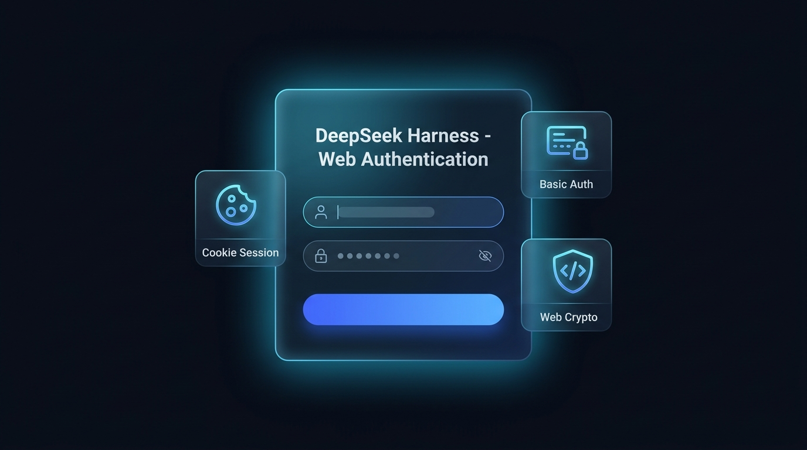

<p align="center">
  
</p>

<div align="center">

# dsh-plugin-auth-webserver

[](LICENSE)
[](https://github.com/kolawong/dsh-plugin-auth-webserver/stargazers)
[](https://github.com/deepseek-ai/deepseek-harness)

**DeepSeek Harness (DSH) 原生 Web 安全认证插件包。**
为云服务器部署、局域网共享和多设备远程访问提供原生外观的 **Web 登录界面**、**Cookie 会话保持**、**Basic Auth 兼容**、**Web GUI 可视化设置** 以及 **Web Crypto Polyfill**，界面支持简体中文与英文。

[English](README.md) | 简体中文

</div>

---

## 核心特性

- **深度匹配 DSH 原生美学的 Web 登录界面**
  - 告别浏览器简陋的原生弹窗，提供暗黑毛玻璃质感、微光边框的网页登录页面。
  - 中英双语（跟随浏览器语言）、密码显示/隐藏切换、错误抖动动画、回车提交，完美适配移动端与桌面端。
- **安全长效的 Cookie / Session 会话机制**
  - 登录成功后自动生成 30 天 HMAC 签名会话 Token，无需反复输入账号密码。
  - 提供 `/api/auth.logout` 退出接口与前端退出按钮。
- **Web GUI 可视化设置卡片**
  - 在 DSH 网页端「设置」->「插件（Plugins）」->「Web 访问认证」中直接查看与修改账号密码。
  - 内存实时生效，并持久化到插件自有的状态文件 `$DSH_HOME/plugins/dsh-plugin-auth-webserver/`，重启后依然生效，且不碰你的配置层。
- **双模鉴权与 WebSocket 实时保护**
  - 网页端优先采用 Web 表单与 Cookie 会话；同时向下兼容 `HTTP Basic Auth`，方便命令行脚本、`curl` 与自动化工具调用。
  - 完整覆盖 HTTP 路由与 WebSocket (`upgrade`) 协议通道。
- **远端 IP 特权 RPC 网关信任委托**
  - 自动处理请求 `Host` / `Origin` 映射，解决公网 IP 访问时 `settings.describe` 与 `agentPreset.*` 报 `HTTP 403 Forbidden` 的问题。
  - 该改写**只对已通过凭据校验的会话生效**：未启用密码时完全跳过，官方回环 `Host` 围栏对 DNS Rebinding 的防御不受影响（见下文「安全」章节）。
- **暴力破解防护与凭据加固**
  - 登录接口与 Basic Auth 双路径按客户端 IP 限速，连续失败 5 次后指数退步锁定（15 秒起步、15 分钟封顶）；凭据比较为常数时间；认证响应带 `no-store` / `nosniff`；密码永不回传到浏览器。
- **Web Crypto UUID 自动 Polyfill**
  - 自动在页面 `<head>` 中注入安全的 UUID 生成器，解决非 HTTPS 或直接 IP 访问时客户端崩溃的问题。

---

## 安全

本插件本身就是自托管部署的安全边界，因此 0.4.0 起按 QVD-2026-57410
（DeepSeek Harness 0.1.1-rc.2 的未授权远程代码执行漏洞，CVSS 9.8）的教训
做了针对性加固。该漏洞的根因是：官方 `/api` 信任围栏用**客户端可伪造的
`Host` 头**判定「回环来源」，而它本身并不是一层认证。本插件的防线：

- **凭据校验先于 `/api` 围栏执行。** 所有 HTTP 与 WebSocket 请求必须先通过
  Cookie / Basic 凭据门，才能触达任何特权 RPC。这正好落在漏洞处置建议的
  「架构级修复」上：特权接口的认证独立于 `Host` 头，不再只靠 loopback 判定。
- **非回环监听默认安全。** 在 `0.0.0.0` 上以空密码启动时，会自动生成高强度
  随机密码（持久化到插件状态文件并在日志中打印一次），而不是把未认证的特权
  RPC 面暴露出去；在非回环监听下从设置卡片清空密码会被直接拒绝。
- **Host/Origin 改写绝不「洗白」未认证请求。** 改写只为通过凭据校验的会话
  背书；没有密码生效时整体跳过——DNS Rebinding 页面带着
  `Host: attacker.example` 到达时，仍会被官方围栏拒绝。
- **抗暴力破解。** 同一 IP 连续 5 次登录失败即锁定，退避时间翻倍增长
  （15 秒起步、15 分钟封顶），登录端点与 Basic Auth 路径同时生效；
  凭据比较全部为常数时间。
- **不回传任何密钥。** `/api/auth.get` 只返回用户名、realm 与「是否已启用
  密码保护」，永不返回密码本身。

推荐的部署姿势：使用足够长的独立密码；如需公网访问，前置 HTTPS 反向代理
并校验 `Host` 头；单人本机使用保持 `127.0.0.1` 绑定；官方发布修复版本后
及时升级 DeepSeek Harness。

---

## 安装

用 `dsh plugin` 把本包安装进 profile：

```bash
# 从 Git 仓库安装（建议锁定 commit，防止后续推送悄悄改变安装行为）：
dsh plugin --profile web add github:kolawong/dsh-plugin-auth-webserver#<commit-sha>

# 或使用 tarball / npm（发布后）：
dsh plugin --profile web add ./dsh-plugin-auth-webserver-0.4.0.tgz
dsh plugin --profile web add dsh-plugin-auth-webserver
```

本包声明了 `dsh.bundle`，`dsh plugin` 会自动把它追加到 profile 的
bundle 列表；它的补丁会禁用内置 `webserver` 行并插入带认证的服务。
随后启动：

```bash
dsh --profile web
```

浏览器访问 `http://你的服务器IP:3080` 即可看到登录页面。

## 配置

所有配置项都有默认值；如需覆盖，请在你的 profile 自己的补丁
（`$DSH_HOME/profiles/web/cordis.patch.yml`，它应用在所有 bundle 层之后）
中覆盖 `webserver-auth` 行：

```yaml
- id: webserver-auth
  config:
    host: '0.0.0.0'
    port: 3080
    username: 'admin'
    password: 'your_secure_password'
```

Web 界面设置卡片中的修改立即生效，并保存到
`$DSH_HOME/plugins/dsh-plugin-auth-webserver/state.json`（权限 0600）。
环境变量 `DSH_AUTH_USER` 与 `DSH_AUTH_PASS` 的优先级高于配置与已保存状态。

| 配置项 | 类型 | 默认值 | 说明 |
|---|---|---|---|
| `host` | `string` | `'0.0.0.0'` | 监听的网络接口地址 (`0.0.0.0` 或 `127.0.0.1`)。 |
| `port` | `number` | `3080` | Web 服务监听端口。 |
| `username` | `string` | `'admin'` | 登录用户名。 |
| `password` | `string` | `''` | 登录密码。留空即关闭密码保护，但**仅在监听 `127.0.0.1` 时允许**；监听 `0.0.0.0` 时会在启动时自动生成随机密码。 |
| `realm` | `string` | `'DeepSeek Harness Authentication'` | Basic Auth 认证领域标识。 |

---

## API 接口

- `POST /api/auth.login` — 用户名密码登录并获取 Session Cookie (`{ username, password }`)。
- `POST /api/auth.logout` — 退出登录并清除 Cookie。
- `GET /api/auth.get` — 获取当前生效的用户名、realm 与密码保护状态（需要已登录；**不返回密码**）。
- `POST /api/auth.update` — 实时修改用户名与密码并持久化（需要已登录；非回环监听时拒绝清空密码）。

---

## 开源协议

本项目采用 [MIT 许可证](LICENSE) © 2026 kola
